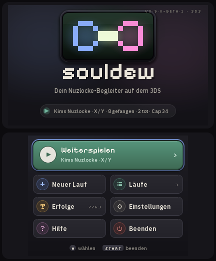
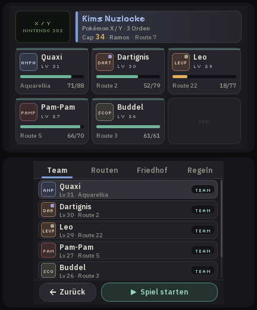
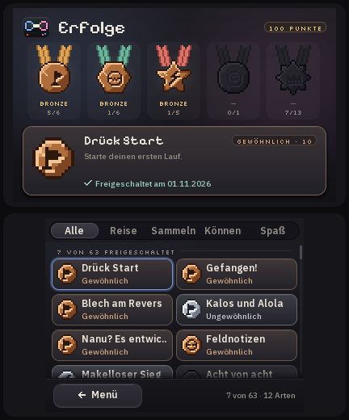

# souldew for Nintendo 3DS

souldew's Nuzlocke tracker on the console itself, for 3DS consoles with custom firmware (Luma3DS):

- **Launcher** (`souldew.3dsx`, Homebrew Launcher): a title menu (Continue, New run, Runs, Achievements, Settings,
  Help), a short introduction on first launch (language, what souldew does, how to open it in game, the Nuzlocke
  basics), create and continue Nuzlocke runs (game, rules: first encounter per area, dupes clause, level caps,
  whiteout, gifts, deathless, hardcore), see team, routes, graveyard and rules, end a run as won or lost – then start
  the installed game or the inserted cartridge.
- **Achievements**: the desktop app's trophies and medals, cut down to what the 3DS games and the plugin can observe
  (63: journey, collection, skill, just for fun – some secret). The medal case and every achievement's progress are in
  the launcher; in game a small card appears when one unlocks.
- **In-game plugin** (`souldew.3gx`, Luma3DS plugin loader, CTRPluginFramework): reads the game's memory while you play.
  The game looks normal; souldew only speaks up in the important moments with a small card on the top screen:
  new area (the first encounter counts), first encounter, dupe, catch, a Pokémon down = dead, over the level cap,
  badge + new cap, evolution, achievement, whiteout. **SELECT** or **holding the small tab in the bottom screen's corner** pauses the game and
  opens souldew's screens (team, routes, graveyard, rules) on both screens; "Back to the game" resumes it.

Games: Pokémon X / Y, Omega Ruby / Alpha Sapphire, Sun / Moon, Ultra Sun / Ultra Moon (all regions share the title
IDs). The memory addresses are the souldew desktop app's (party, battles, zone, badges). Virtual Console titles (GB/GBA)
are not supported (see REPORT.md).

The launcher and the plugin share the runs, the settings and the achievements in `sdmc:/souldew/runs.json`.

 
 

## Install

Beta testers: **docs/TESTERS.md** (Universal-Updater QR code, FBI QR code or the SD card zip). Publishing a beta:
**docs/RELEASING.md**.

Needs Luma3DS **v13 or newer** (it has the plugin loader built in).

| File | Where on the SD card |
| --- | --- |
| `souldew.cia` | installed with FBI / Universal-Updater → HOME menu icon (title ID `000400000F5D3D00`) |
| `souldew.3dsx` | `/3ds/souldew/souldew.3dsx` (Homebrew Launcher – the same app) |
| `souldew.3gx` | `/3ds/souldew/souldew.3gx` |

The plugin also travels inside the app (RomFS of the `.cia` and the `.3dsx`): on every start the launcher writes it
to `/3ds/souldew/souldew.3gx` when that file is missing or differs, so the `.cia` or the `.3dsx` alone is a complete
install. `./build.sh` puts the SD card layout in `dist/sd/` (copy its contents to the SD card's root) and the beta
release files in `dist/release/`.

1. Turn the plugin loader on once: open the Rosalina menu (**L + D-pad down + SELECT**) › *Plugin Loader: [Enabled]*
   (the launcher also offers to switch it on when you start a game).
2. Start *souldew* (HOME menu or Homebrew Launcher), create a run, press *Start game*. The launcher tells Luma to load
   `/3ds/souldew/souldew.3gx` for that game and starts it.

Without the launcher: put `souldew.3gx` into `/luma/plugins/<title ID>/` (`dist/sd-alternative/` has all eight
folders) – the plugin then loads every time the game starts, picks the newest active run for that game or creates one.
Don't use both ways at once for the same game.

## Use

- In the game: nothing changes until something matters. **SELECT** (or hold the bottom-right tab for a moment) opens
  souldew; **B**, **SELECT** or the big button returns to the game. **L / R** switch tabs, the D-pad moves, **A** opens
  a row: mark a Pokémon dead by hand, or confirm an encounter whose catch went to the box (party full).
- Gen 7 has no badges: step the grand trials in the *Rules* tab (**− / +**) – the level cap follows.
- *Settings* in the launcher: language (Deutsch / English), overlays in game, the corner tab, the introduction again.
  In game the *Rules* tab toggles the overlays. *Rules › End the run* marks a run as won or lost (achievements).

## Build

```sh
./build.sh          # Docker toolchain + host tests + screenshots → dist/
./build.sh host     # only tests and screenshots (C++17 compiler, no Docker)
```

The toolchain image (`docker/Dockerfile`): devkitARM/libctru (pinned by digest), libctrpf (CTRPluginFramework),
3gxtool, makerom, ctrtool and bannertool built from pinned sources. Outputs:

- `launcher/souldew.3dsx`, `launcher/souldew.cia`, `plugin/souldew.3gx` – the release files (version: `kVersion` in
  `common/screens.h`; the `.cia`'s banner and jingle come from `tools/gen_cia_assets.py` → `launcher/cia/`, its
  makerom settings are `launcher/cia/souldew.rsf`)
- `dist/release/` – the beta's upload set (`.cia`, `.3dsx`, `.3gx`, `souldew.unistore`, `souldew.t3x`, the SD card
  zip), `dist/qr/` – the QR codes (`tools/make_release.py`, see docs/RELEASING.md); `build/cia_info.txt` – ctrtool's
  view of the `.cia`
- `launcher/souldew-demo.3dsx` – the launcher pressing its own buttons (emulator screenshots)
- `plugin/souldew-test.3gx` + `mockgame/souldew-mock.cxi` – the plugin's end-to-end test without any game (below)
- `docs/screenshots/*.png` – every screen in German and English (`*_en.png`), rendered on the computer by the same
  drawing code the console runs (`docs/screenshots/before/`: a few screens before the redesign of 13 Nov 2026)

Generated sources are committed; regenerate them with `tools/gen_fonts.py` (fonts, needs Pillow), `tools/gen_icon.py`
/ `tools/gen_cia_assets.py` (icon, the `.cia`'s banner + jingle, Pillow),
`tools/gen_data.mjs <souldew>/native/shared/data` (names, types, locations) and `tools/gen_mock_romfs.py`.

## Test

- `./build.sh host` runs the unit tests (`host/tests.cpp`): PK6/PK7 decryption against fixtures written by the desktop
  app's own JavaScript (`tools/js_fixtures.mjs`), the party/battle readers, RomFS/GARC/LZ11 zone tables (cross-checked
  with the desktop app's `ctrzones.mjs`: `tools/js_check_zones.mjs`), the run file, the rules engine and the moments it
  records, the achievements and medals, every framebuffer format, the screens' keys and touch targets.
- `python3 tools/emu_test.py plugin <Azahar.app>` runs the **mock game** in Azahar (2126.2) with the test plugin: a
  homebrew test title (title ID `000400000F5D0000`) that lays out its memory like Pokémon X 1.0 and plays a scripted
  Nuzlocke (town → route → first encounter → catch → dupe → over the cap → trainer battle → death → badge) – the real
  plugin reads it, draws its overlays, writes the run file, and opens souldew's screens once by itself. Screenshots:
  `docs/screenshots/emu_plugin_*.png`.
- `python3 tools/emu_test.py launcher <Azahar.app>` runs the launcher's demo build: it presses its own buttons through
  the introduction, the menu, a run's tabs, the achievements, the settings and the new-run wizard
  (`docs/screenshots/emu_launcher_*.png`). It starts without the plugin on the SD card and checks that the launcher
  installed it from its RomFS.
- `python3 tools/emu_test.py cia <Azahar.app>` boots the program inside `souldew.cia` (its NCCH, `build/souldew-cia.cxi`)
  on an empty SD card: first screen + the same plugin check (`docs/screenshots/emu_cia_intro.png`).

Azahar runs in portable mode (a `user/` folder next to `Azahar.app`), silent (audio output "null", volume 0).

## Layout

```
common/     platform-free C++: drawing canvas, fonts, UI, run file, Nuzlocke engine, PK6/PK7 + battle + zone readers
launcher/   the .3dsx (libctru) + the plg:ldr client
plugin/     the .3gx (CTRPluginFramework)
mockgame/   the test title for the plugin
host/       unit tests + screenshot renderer
tools/      generators and the emulator test
```

License: GPL-3.0 (see LICENSE). Third-party parts: NOTICE.md. souldew is not affiliated with or endorsed by Nintendo,
Game Freak or The Pokémon Company.
