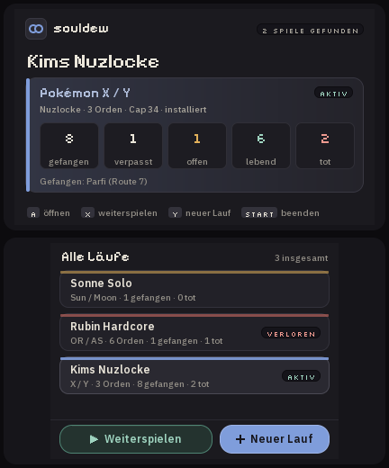
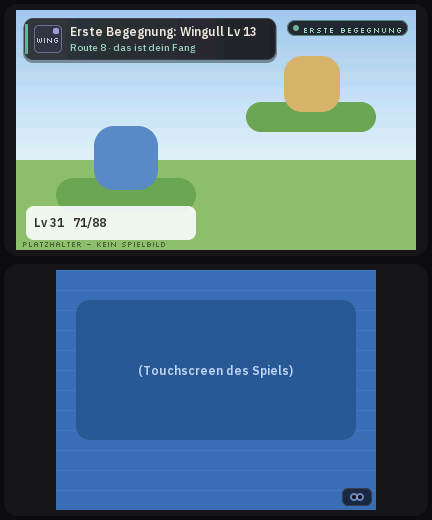

# souldew for Nintendo 3DS

souldew's Nuzlocke tracker on the console itself, for 3DS consoles with custom firmware (Luma3DS):

- **Launcher** (`souldew.3dsx`, Homebrew Launcher): create and continue Nuzlocke runs (game, rules: first encounter per
  area, dupes clause, level caps, whiteout, gifts, deathless, hardcore), see team, routes, graveyard and rules – then
  start the installed game or the inserted cartridge.
- **In-game plugin** (`souldew.3gx`, Luma3DS plugin loader, CTRPluginFramework): reads the game's memory while you play.
  The game looks normal; souldew only speaks up in the important moments with a small card on the top screen:
  new area (the first encounter counts), first encounter, dupe, catch, a Pokémon fainted = dead, over the level cap,
  badge + new cap, whiteout. **SELECT** or **holding the small tab in the bottom screen's corner** pauses the game and
  opens souldew's screens (team, routes, graveyard, rules) on both screens; "Back to the game" resumes it.

Games: Pokémon X / Y, Omega Ruby / Alpha Sapphire, Sun / Moon, Ultra Sun / Ultra Moon (all regions share the title
IDs). The memory addresses are the souldew desktop app's (party, battles, zone, badges). Virtual Console titles (GB/GBA)
are not supported (see REPORT.md).

The launcher and the plugin share the run in `sdmc:/souldew/runs.json`.

 

## Install (SD card)

Needs Luma3DS **v13 or newer** (it has the plugin loader built in) and the Homebrew Launcher.

| File | Where on the SD card |
| --- | --- |
| `souldew.3dsx` | `/3ds/souldew/souldew.3dsx` |
| `souldew.3gx` | `/3ds/souldew/souldew.3gx` |

`./build.sh` puts both in `dist/sd/` with that layout – copy the contents of `dist/sd/` to the SD card's root.

1. Turn the plugin loader on once: open the Rosalina menu (**L + D-pad down + SELECT**) › *Plugin Loader: Enabled*
   (the launcher also offers to switch it on when you start a game).
2. Start *souldew* in the Homebrew Launcher, create a run, press *Start game*. The launcher tells Luma to load
   `/3ds/souldew/souldew.3gx` for that game and starts it.

Without the launcher: put `souldew.3gx` into `/luma/plugins/<title ID>/` (`dist/sd-alternative/` has all eight
folders) – the plugin then loads every time the game starts, picks the newest active run for that game or creates one.
Don't use both ways at once for the same game.

## Use

- In the game: nothing changes until something matters. **SELECT** (or hold the bottom-right tab for a moment) opens
  souldew; **B**, **SELECT** or the big button returns to the game. **L / R** switch tabs, the D-pad moves, **A** opens
  a row: mark a Pokémon dead by hand, or confirm an encounter whose catch went to the box (party full).
- Gen 7 has no badges: step the grand trials in the *Rules* tab (**− / +**) – the level cap follows.
- Settings live in the run file (`settings.lang`: `"de"` / `"en"`, `overlays`, `tab`). The *Rules* tab toggles overlays.

## Build

```sh
./build.sh          # Docker toolchain + host tests + screenshots → dist/
./build.sh host     # only tests and screenshots (C++17 compiler, no Docker)
```

The toolchain image (`docker/Dockerfile`): devkitARM/libctru (pinned by digest), libctrpf (CTRPluginFramework),
3gxtool and makerom built from pinned sources. Outputs:

- `launcher/souldew.3dsx`, `plugin/souldew.3gx` – the release files
- `launcher/souldew-demo.3dsx` – the launcher pressing its own buttons (emulator screenshots)
- `plugin/souldew-test.3gx` + `mockgame/souldew-mock.cxi` – the plugin's end-to-end test without any game (below)
- `docs/screenshots/*.png` – every screen, rendered on the computer by the same drawing code the console runs

Generated sources are committed; regenerate them with `tools/gen_fonts.py` (fonts, needs Pillow),
`tools/gen_data.mjs <souldew>/native/shared/data` (names, types, locations) and `tools/gen_mock_romfs.py`.

## Test

- `./build.sh host` runs the unit tests (`host/tests.cpp`): PK6/PK7 decryption against fixtures written by the desktop
  app's own JavaScript (`tools/js_fixtures.mjs`), the party/battle readers, RomFS/GARC/LZ11 zone tables (cross-checked
  with the desktop app's `ctrzones.mjs`: `tools/js_check_zones.mjs`), the run file, the rules engine, every framebuffer
  format, the screens' touch targets.
- `python3 tools/emu_test.py plugin <Azahar.app>` runs the **mock game** in Azahar (2126.2) with the test plugin: a
  homebrew test title (title ID `000400000F5D0000`) that lays out its memory like Pokémon X 1.0 and plays a scripted
  Nuzlocke (town → route → first encounter → catch → dupe → over the cap → trainer battle → death → badge) – the real
  plugin reads it, draws its overlays, writes the run file, and opens souldew's screens once by itself. Screenshots:
  `docs/screenshots/emu_plugin_*.png`.
- `python3 tools/emu_test.py launcher <Azahar.app>` runs the launcher's demo build.

Azahar runs in portable mode (a `user/` folder next to `Azahar.app`), silent (audio output "null", volume 0).

## Layout

```
common/     platform-free C++: drawing canvas, fonts, UI, run file, Nuzlocke engine, PK6/PK7 + battle + zone readers
launcher/   the .3dsx (libctru) + the plg:ldr client
plugin/     the .3gx (CTRPluginFramework)
mockgame/   the test title for the plugin
host/       unit tests + screenshot renderer
tools/      generators and the emulator test
```

License: GPL-3.0 (see LICENSE). Third-party parts: NOTICE.md. souldew is not affiliated with or endorsed by Nintendo,
Game Freak or The Pokémon Company.
